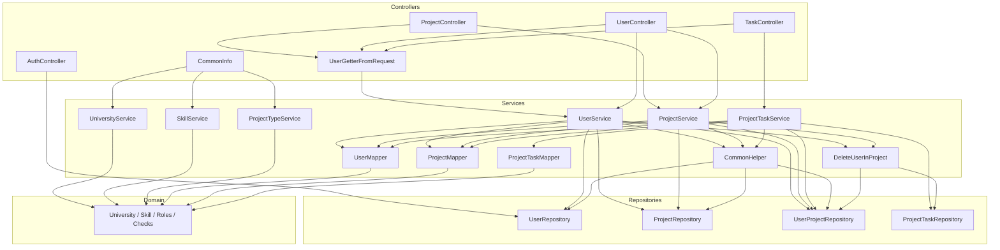
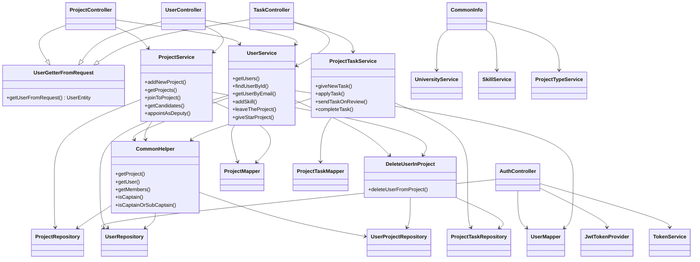
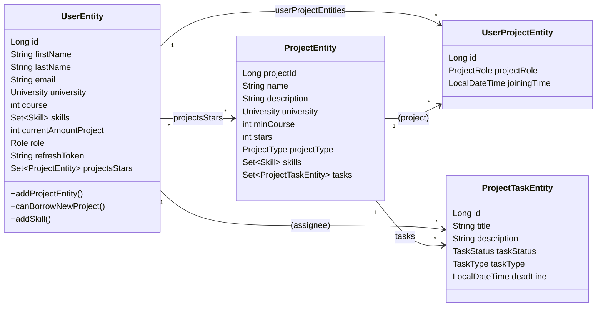
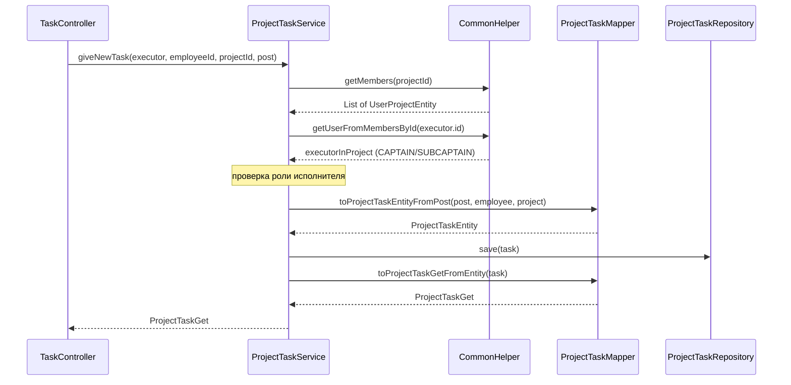

# Архитектура UniTeam

Документ описывает структуру backend-модуля, слои приложения, связи между классами и покрытие тестами.

## Обзор

Проект разделён на два Gradle-модуля:

| Модуль | Назначение |
|--------|------------|
| **domain** | Чистая доменная логика без Spring: enum'ы, value-object'ы, use-case'ы валидации, исключения |
| **webplatform** (root) | Spring Boot приложение: контроллеры, сервисы, JPA-сущности, репозитории, JWT/Security |

```
┌─────────────────────────────────────────────────────────────┐
│                        Frontend (Node)                       │
│                   http://localhost:3000                      │
└────────────────────────────┬────────────────────────────────┘
                             │ REST /api/v0/*
┌────────────────────────────▼────────────────────────────────┐
│                     Controllers (REST)                       │
│  opened: AuthController, CommonInfo                          │
│  closed: ProjectController, UserController, TaskController   │
└────────────────────────────┬────────────────────────────────┘
                             │
┌────────────────────────────▼────────────────────────────────┐
│                        Services                              │
│  UserService · ProjectService · ProjectTaskService           │
│  UniversityService · SkillService · ProjectTypeService       │
│  CommonHelper · DeleteUserInProject · Mappers                │
└──────────────┬─────────────────────────────┬────────────────┘
               │                             │
┌──────────────▼──────────────┐  ┌───────────▼────────────────┐
│     JPA Repositories        │  │   domain (чистая логика)   │
│  UserRepository             │  │  University, Skill, Roles  │
│  ProjectRepository          │  │  CheckEmail, CheckCourse…  │
│  UserProjectRepository      │  │  CanUserBorrowProject      │
│  ProjectTaskRepository      │  └────────────────────────────┘
└──────────────┬──────────────┘
               │
┌──────────────▼──────────────┐
│     PostgreSQL / H2 (test)  │
└─────────────────────────────┘
```

## Слои

### 1. Controllers (`controllers`)

| Класс | Префикс | Доступ |
|-------|---------|--------|
| `AuthController` | `/api/v0/auth` | открытый |
| `CommonInfo` | `/api/v0/info` | открытый |
| `ProjectController` | `/api/v0/projects` | JWT |
| `UserController` | `/api/v0/users` | JWT |
| `TaskController` | `/api/v0/tasks` (и `/users/tasks`) | JWT |
| `UserGetterFromRequest` | — | базовый класс: достаёт `UserEntity` из `SecurityContext` |
| `GlobalExceptionHandler` | — | единый обработчик исключений |

### 2. Services (`data/services`)

| Сервис | Зависимости | Ответственность |
|--------|-------------|-----------------|
| `UserService` | UserRepository, UserMapper, UserProjectRepository, ProjectRepository, ProjectMapper, CommonHelper, DeleteUserInProject | профиль, навыки, звёзды, выход из проекта |
| `ProjectService` | ProjectRepository, ProjectMapper, UserProjectRepository, UserMapper, CommonHelper, DeleteUserInProject | CRUD проектов, заявки, роли |
| `ProjectTaskService` | ProjectTaskRepository, CommonHelper, ProjectTaskMapper, UserMapper, ProjectMapper, UserProjectRepository | жизненный цикл задач |
| `CommonHelper` | ProjectRepository, UserRepository, UserProjectRepository | общие проверки и поиск сущностей |
| `DeleteUserInProject` | ProjectTaskRepository, UserProjectRepository | удаление участника вместе с его задачами |
| `UniversityService` / `SkillService` / `ProjectTypeService` | — | справочники из domain-enum'ов |

**Мапперы** (`UserMapper`, `ProjectMapper`, `ProjectTaskMapper`) — преобразование Entity ↔ DTO.

### 3. Repositories (`data/repositories`)

Spring Data JPA-интерфейсы:

- `UserRepository` — пользователи, поиск по email / вузу / курсу
- `ProjectRepository` — проекты, сортировка по звёздам, фильтры
- `UserProjectEntity` — связь пользователь–проект (роль, дата вступления)
- `ProjectTaskRepository` — задачи, удаление по пользователю+проекту

### 4. Entities (`data/entities`)

```
UserEntity 1────* UserProjectEntity *────1 ProjectEntity
                      │
                      │ (роль: CAPTAIN / SUBCAPTAIN / EMPLOYEE / CANDIDATE / CANCELLED)
                      │
UserEntity 1────* ProjectTaskEntity *────1 ProjectEntity
```

- `UserEntity` — профиль, навыки, число проектов, refresh-token, звёзды проектов
- `ProjectEntity` — название, описание, вуз, мин. курс, стек, тип, звёзды
- `UserProjectEntity` — связь many-to-many с ролью
- `ProjectTaskEntity` — задача: статус, тип, дедлайн, исполнитель, проект

### 5. Domain (`domain`)

Без зависимостей от Spring:

- **Enum'ы:** `University`, `Skill`, `ProjectType`, `TaskType`, `TaskStatus`, `ProjectRole`, `Role`
- **Use-case'ы валидации:** `CheckEmailUseCase`, `CheckCourse`, `CheckNotNull`, `CheckUniversity`, `CheckUserSkills`, `CheckUniversityStack`, `CanUserBorrowProject`
- **Исключения:** `IncorrectUserEmailException`, `PermissionException`, `UserHasTooManyProjectsException`, …
- **Value object:** `UserData` (абстрактный), `Pair<T,M>`

### 6. Security (`data/auth`)

- `SecurityConfig` — цепочка фильтров, CORS, правила доступа
- `JwtAuthenticationFilter` + `JwtTokenProvider` — access/refresh JWT
- `TokenService` — сохранение refresh-токена в БД
- `CustomUserDetails` / `CustomUserDetailsService` — интеграция с Spring Security

---

## UML: связи между классами

### Диаграмма компонентов (слои)



### Диаграмма классов: сервисы и зависимости



### Диаграмма классов: сущности JPA



### Диаграмма последовательности: выдача задачи



---

## Тесты

### Структура

```
src/test/java/ru/uniteam/webplatform/
├── TestDataFactory.java              # фабрика сущностей для тестов
├── WebplatformApplicationTests.java
├── controllers/
│   ├── closed/
│   │   ├── ProjectControllerTest.java
│   │   ├── UserControllerTest.java
│   │   ├── TaskControllerTest.java
│   │   └── UserGetterFromRequestTest.java
│   └── opened/
│       └── CommonInfoTest.java
└── data/
    ├── services/
    │   ├── CommonHelperTest.java
    │   ├── CommonServicesTest.java
    │   ├── users/
    │   │   ├── UserServiceTest.java
    │   │   └── UserMapperTest.java
    │   ├── projects/
    │   │   ├── ProjectServiceTest.java
    │   │   └── ProjectMapperTest.java
    │   └── tasks/
    │       ├── ProjectTaskServiceTest.java
    │       └── ProjectTaskMapperTest.java
    └── entities/usecases/
        └── DeleteUserInProjectTest.java

domain/src/test/java/ru/uniteam/
├── datastructure/PairTest.java
├── models/
│   ├── EnumsTest.java
│   ├── ExceptionsTest.java
│   ├── SkillTest.java
│   ├── UniversityTest.java
│   └── UserDataTest.java
└── usecases/
    ├── CanUserBorrowProjectTest.java
    ├── CheckCourseTest.java
    ├── CheckEmailUseCaseTest.java
    ├── CheckNotNullTest.java
    ├── CheckUniversityTest.java
    └── skills/CheckUserSkillsTest.java
```

### Подход

| Тип | Инструменты | Что покрыто |
|-----|-------------|-------------|
| Unit (domain) | JUnit 5 | валидация, enum'ы, исключения, `UserData` |
| Unit (src) | JUnit 5 + **Mockito** | сервисы, мапперы, контроллеры, CommonHelper |
| Репозитории | моки в service-тестах | не поднимаем БД в unit-тестах |
| Контекст Spring | H2 в `src/test/resources` | при необходимости integration |

### Запуск

```bash
# все тесты + отчёт Jacoco
./gradlew test jacocoTestReport

# только domain
./gradlew :domain:test

# отчёт покрытия
# build/reports/jacoco/test/html/index.html
```

### Зависимости для тестов (уже в `build.gradle.kts`)

- `spring-boot-starter-*-test`
- `mockito-core` / `mockito-junit-jupiter`
- `h2` (testRuntimeOnly)
- плагин **Jacoco**

---

## Ключевые инварианты

1. Пользователь — не более **10 навыков** и **5 проектов**.
2. В стеке проекта — не более **20 технологий**.
3. Заявку на проект можно подать только при `course >= project.minCourse`.
4. Задачи выдают только CAPTAIN / SUBCAPTAIN; ревью — с учётом иерархии ролей.
5. При уходе последнего участника проект удаляется; при уходе капитана роль переходит заместителю или другому участнику.
